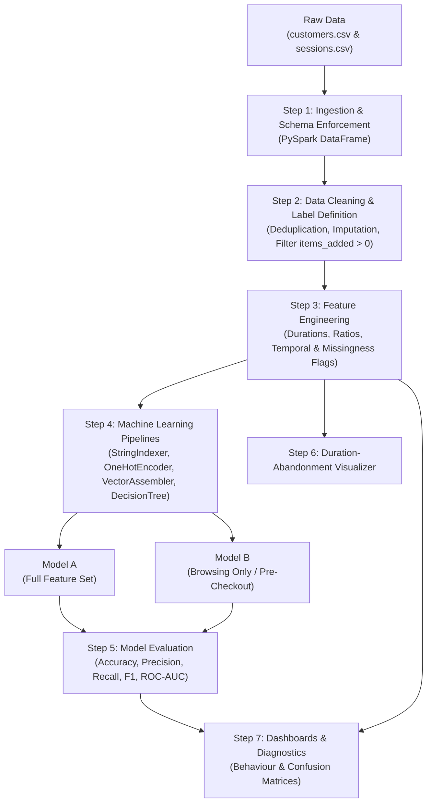
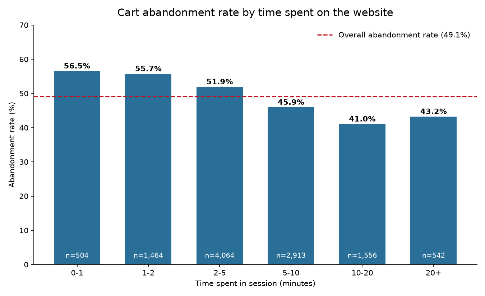
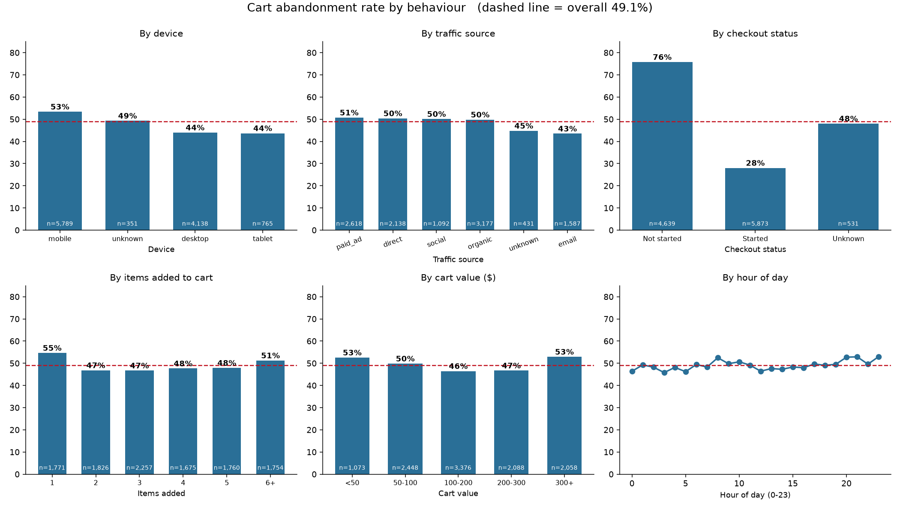
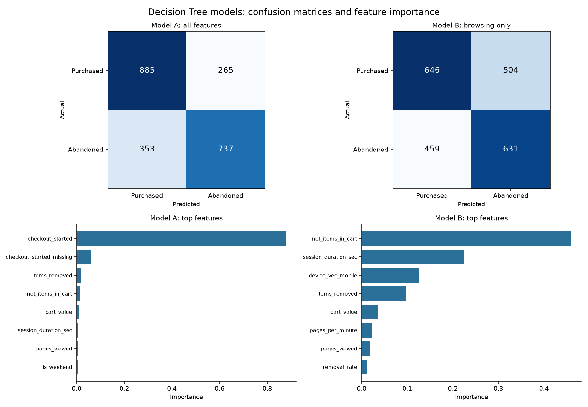

# 🛒 E-Commerce Cart Abandonment Analysis & Predictive Modeling

[](https://www.python.org/)
[](https://spark.apache.org/)
[](https://spark.apache.org/mllib/)
[](https://matplotlib.org/)
[](LICENSE)

An end-to-end Big Data & Machine Learning project using **Apache PySpark** to clean, analyze, and predict e-commerce shopping cart abandonment. The solution models customer session behavior and builds decision tree classifiers to identify shoppers at risk of abandoning their carts in real-time.

---

## 📌 Table of Contents

- [Overview & Objectives](#-overview--objectives)
- [Key Insights & Findings](#-key-insights--findings)
- [Pipeline Architecture](#-pipeline-architecture)
- [Dataset Overview](#-dataset-overview)
- [Feature Engineering](#-feature-engineering)
- [Machine Learning Models](#-machine-learning-models)
- [Model Evaluation & Diagnostics](#-model-evaluation--diagnostics)
- [Visualizations](#-visualizations)
- [Project Structure](#-project-structure)
- [Getting Started](#-getting-started)
- [Running the Pipeline](#-running-the-pipeline)
- [Actionable Business Recommendations](#-actionable-business-recommendations)

---

## 🎯 Overview & Objectives

In e-commerce, the majority of shopping carts are abandoned prior to checkout, representing billions in lost revenue. This project leverages **PySpark** and **PySpark MLlib** to:

1. **Ingest & Cleanse** large-scale customer profile and session logs with robust schema enforcement.
2. **Handle Incomplete & Noisy Data**: Impute missing metrics, flag missingness as behavioral signals, and filter to valid cart sessions.
3. **Engineer Behavioral Indicators**: Session duration, item removal rates, cart-to-view ratios, pacing, and temporal markers.
4. **Train Predictive Models**:
   - **Model A (Full Feature Set)**: Utilizes both browsing signals and checkout initiation status.
   - **Model B (Early Browsing Signal)**: Predicts abandonment *before* the customer reaches the checkout step.
5. **Generate Diagnostic Dashboards & Actionable Insights** for targeted re-engagement and checkout optimization.

---

## 💡 Key Insights & Findings

- **Checkout Friction**: Shoppers who start checkout are substantially more likely to convert; not initiating checkout is the single strongest predictor of cart abandonment.
- **Item Removal Rate**: Sessions with higher `removal_rate` (`items_removed / items_added`) have an elevated probability of abandonment, signaling price comparison or reconsideration.
- **Session Duration Dynamics**:
  - Extremely short sessions (< 2 minutes) with items added show high bounce/abandonment rates.
  - Very long sessions (> 20 minutes) also exhibit drop-offs due to cart fatigue or decision paralysis.
- **Device Disparity**: Mobile users consistently abandon carts at a higher frequency than desktop shoppers, pointing toward mobile checkout UI/UX friction.

---

## 🏗 Pipeline Architecture



---

## 📊 Dataset Overview

The pipeline operates on two relational datasets joined on `customer_id`:

### 1. `customer_table.csv`
- `customer_id`: Unique customer identifier
- `customer_name`: Shopper name
- `age`: Customer age
- `gender`: Gender category
- `city`: Location / City

### 2. `sessions.csv`
- `session_id`: Unique web session ID
- `customer_id`: Mapping to customer profile
- `session_start` / `session_end`: Timestamps for session duration
- `pages_viewed`: Total web pages visited
- `product_views`: Number of product detail pages viewed
- `items_added`: Number of items added to shopping cart
- `items_removed`: Number of items removed from shopping cart
- `cart_value`: Total monetary value in the cart ($)
- `checkout_started`: Indicator (1/0) if user initiated checkout
- `device`: Device type (`Mobile`, `Desktop`, `Tablet`)
- `traffic_source`: Acquisition channel (`Organic`, `Direct`, `Paid`, `Social`, `Email`)
- `purchased`: Purchase outcome (1 = purchased, 0 = abandoned)

---

## ⚙️ Feature Engineering

| Feature | Type | Definition & Logic |
| :--- | :--- | :--- |
| `abandoned` | Label | `1` if `purchased == 0` else `0` (scoped to `items_added > 0`) |
| `session_duration_sec` | Numeric | Difference between session start and end (imputed with page rate) |
| `session_duration_min` | Numeric | Duration converted to minutes |
| `net_items_in_cart` | Numeric | `items_added - items_removed` |
| `removal_rate` | Numeric | `items_removed / items_added` (signals purchase doubt) |
| `avg_item_price` | Numeric | `cart_value / items_added` |
| `cart_to_view_ratio` | Numeric | `items_added / max(product_views, 1)` |
| `pages_per_minute` | Numeric | Browsing speed: `pages_viewed / max(duration_min, 0.1)` |
| `hour_of_day` | Numeric | Hour component (0–23) of `session_start` |
| `day_of_week` | Numeric | Day of the week (1=Sunday ... 7=Saturday) |
| `is_weekend` | Binary | `1` if Saturday/Sunday, else `0` |
| `*_missing` | Binary | Explicit missingness flags for incomplete session attributes |

---

## 🤖 Machine Learning Models

Using **PySpark MLlib Pipeline**, categorical features (`device`, `traffic_source`, `gender`, `city`) are processed with `StringIndexer` and `OneHotEncoder`, assembled into a feature vector via `VectorAssembler`, and fed to a `DecisionTreeClassifier` (`maxDepth=5`, `minInstancesPerNode=20`).

Two configurations are trained and evaluated on an **80/20 train/test split**:

1. **Model A (All Features)**:
   - Includes `checkout_started` and checkout missingness.
   - Evaluates overall prediction capability when the customer is at or near the final conversion funnel step.
2. **Model B (Browsing Behavior Only)**:
   - Excludes checkout signals.
   - Evaluates early proactive intervention (e.g., triggering exit-intent popups, discounts, or live chat while the user is still browsing).

---

## 📈 Model Evaluation & Diagnostics

Evaluation metrics tracked in `step5_evaluate.py`:

- **Accuracy**: Overall classification correctness compared against the majority-class baseline.
- **Recall (abandoned = 1)**: Proportion of actual cart abandoners successfully identified.
- **Precision (abandoned = 1)**: Proportion of flagged sessions that truly abandon.
- **F1-Score**: Harmonic mean of Precision and Recall.
- **Area Under ROC (AUC)**: Discriminative threshold-independent performance.

---

## 🖼 Visualizations

### 1. Cart Abandonment by Session Duration
Illustrates abandonment rate categorized across session time buckets (0-1 min, 1-2 min, 2-5 min, 5-10 min, 10-20 min, 20+ min) relative to the global abandonment benchmark.



### 2. Behavioral Breakdown Dashboard
A multi-panel analysis showing abandonment patterns segmented by device, traffic source, checkout status, item volume, cart value, and hour of day.



### 3. Model Diagnostics Panel
Decision Tree confusion matrices and top feature importances for both Model A and Model B.



---

## 📁 Project Structure

```text
cart_project/
├── abandonment_by_time_spent.png   # Visualization: Duration vs abandonment rate
├── abandonment_dashboard.png       # 6-panel behavioural analysis dashboard
├── model_diagnostics.png           # Confusion matrices & feature importances
├── customer_table.csv              # Customer demographics dataset
├── sessions.csv                    # Web session clickstream dataset
├── step1_load_data.py              # Ingests datasets into PySpark DataFrames
├── step2_clean_data.py             # Data cleansing, imputation & label definition
├── step3_features.py               # Feature engineering & transformations
├── step4_decision_tree.py          # PySpark ML pipeline & Decision Tree training
├── step5_evaluate.py               # Model evaluation & performance metrics
├── step6_visualize.py              # Plots abandonment rate by duration
├── step7_more_visuals.py           # Generates multi-panel dashboards
├── viz_helpers.py                  # Matplotlib plotting helper functions
├── run_pipeline.py                 # Master execution script for end-to-end pipeline
├── officalccreport.docx            # Detailed analytical & academic report
├── requirements.txt                # Python project dependencies
├── .gitignore                      # Git ignore patterns
└── README.md                       # Comprehensive project documentation
```

---

## 🚀 Getting Started

### Prerequisites

- **Python**: 3.9+ installed
- **Java**: Java 8, 11, or 17 (required for Apache Spark)
- **Apache Spark / PySpark**: 3.4+

### Installation

1. **Clone the repository**:
   ```bash
   git clone https://github.com/polagonibalajigoud/cart-abandonment-analysis.git
   cd cart-abandonment-analysis
   ```

2. **Create and activate a virtual environment**:
   ```bash
   python -m venv .venv
   # Windows (PowerShell):
   .venv\Scripts\Activate.ps1
   # macOS / Linux:
   source .venv/bin/activate
   ```

3. **Install dependencies**:
   ```bash
   pip install -r requirements.txt
   ```

---

## ⚡ Running the Pipeline

### Option 1: Run the Complete Pipeline (Recommended)
Execute all steps sequentially in a single Spark session:
```bash
python run_pipeline.py
```

### Option 2: Run Step-by-Step in PySpark Shell
You can run individual modules sequentially in an interactive `pyspark` shell:
```python
exec(open("step1_load_data.py").read())
exec(open("step2_clean_data.py").read())
exec(open("step3_features.py").read())
exec(open("step4_decision_tree.py").read())
exec(open("step5_evaluate.py").read())
exec(open("step6_visualize.py").read())
exec(open("step7_more_visuals.py").read())
```

---

## 💼 Actionable Business Recommendations

1. **Streamline Mobile Checkout**: Address the higher abandonment on mobile devices through one-click checkout (Apple Pay / Google Pay / Shop Pay) and minimal form fields.
2. **Early Exit-Intent Triggers (Model B)**: Intervene before shoppers leave by detecting high removal rates or stalling browse sessions with targeted incentives or live support.
3. **Cart Re-engagement Automation**: Automate personalized email and push reminders triggered within 1-2 hours of cart abandonment with dynamic cart item summaries.
4. **Transparent Shipping & Pricing**: Avoid cart sticker shock by clearly communicating shipping fees and taxes early on product detail pages.

---

## 📄 License

This project is licensed under the MIT License - see the [LICENSE](LICENSE) file for details.

## 👤 Author

**Balaji Polagoni**
- GitHub: [@polagonibalajigoud](https://github.com/polagonibalajigoud)
